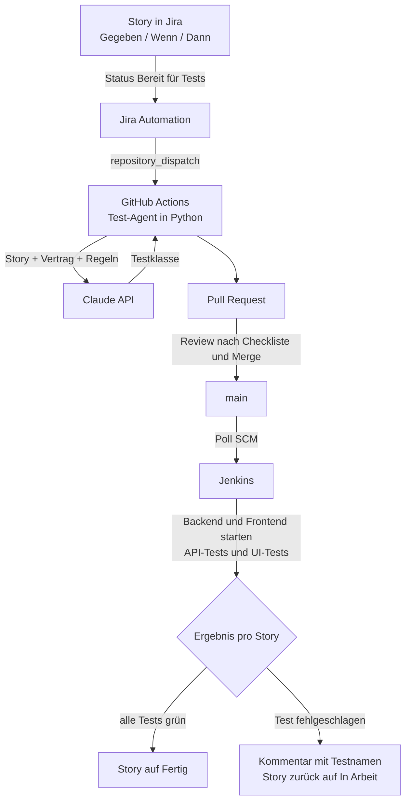

# TaskBoard – KI-gestützte Testautomatisierung

Ein Portfolio-Projekt, das eine geschlossene Kette von der Anforderung bis zum Testergebnis zeigt: User Stories in Jira werden per Trigger an einen KI-Agenten übergeben, der daraus Tests erzeugt. Nach dem Review laufen die Tests in Jenkins gegen ein Spring-Boot-Backend und ein Angular-Frontend, und das Ergebnis wird pro Story zurück an Jira gemeldet.

Das Testobjekt ist eine kleine Aufgabenverwaltung (TaskBoard). Der Schwerpunkt liegt auf der Qualitätssicherung: Shift Left, Contract First, TDD und ein nachvollziehbarer Weg von jedem Szenario zu seinem Test.

> **Stand:** Alle fünf User Stories sind im Backend und im Frontend umgesetzt. **26 API-Tests und 21 UI-Tests sind grün.** Die Kette Jira → KI-Agent → Pull Request → Jenkins → Jira läuft automatisch. Aktuell entstehen die Entwürfe in Figma und daraus UI-Stories zu Gestaltung und Barrierefreiheit.

## Ablauf



1. Eine User Story wird in Jira mit Szenarien im Format Gegeben / Wenn / Dann beschrieben.
2. Wird die Story in den Status **Bereit für Tests** verschoben, startet eine Jira-Automatisierung per Web-Anfrage einen GitHub-Actions-Workflow. Übergeben wird nur der Story-Schlüssel.
3. Der Test-Agent holt die Story über die Jira-REST-API, kombiniert sie mit dem passenden Vertrag und festen Regeln und lässt daraus eine Testklasse erzeugen.
4. Das Ergebnis landet als Pull Request auf einem eigenen Branch `ki-tests/TB-x`. Kein generierter Test gelangt ohne manuelles Review in `main`.
5. Die Tests sind zunächst rot. Die Anwendung wird so lange weiterentwickelt, bis sie grün sind (TDD).
6. Jenkins baut bei jedem Commit das Backend, startet es mit einer eigenen Test-Datenbank, führt die API-Tests aus, startet dann das Frontend und führt die UI-Tests im Browser aus.
7. Ein Skript wertet die Testberichte aus und meldet das Ergebnis an die passende Story: Sind alle API- und UI-Tests einer Story grün, wird sie auf **Fertig** gesetzt. Schlägt ein Test fehl, bekommt sie einen Kommentar mit den betroffenen Tests und einem Link zum Jenkins-Bericht und wandert zurück auf **In Arbeit**.

## Zwei Agenten, zwei Verträge

| Agent | Grundlage | Erzeugt |
|---|---|---|
| API-Test-Agent (`ai/generate_tests.py`) | [API-Vertrag](docs/api-vertrag.md): Endpunkte, Statuscodes, Meldungen | JUnit-5-Tests mit REST Assured |
| UI-Test-Agent (`ai/generate_ui_tests.py`) | [UI-Vertrag](docs/ui-vertrag.md): Seiten, Elemente mit `data-testid`, Verhalten | Playwright-Tests in Java mit Page Objects |

Die Verträge sind die gemeinsame Sprache zwischen Story, Anwendung und Test. Die KI rät keine Adressen oder Selektoren, sie übernimmt sie aus dem Vertrag.

## Was das Projekt zeigt

- **Shift Left:** Anforderungen, Grenzwerte und Fehlerfälle werden in der Story festgelegt, bevor es Code gibt.
- **Contract First:** API-Vertrag und UI-Vertrag beschreiben, was Backend und Frontend liefern müssen. Tests und Anwendung richten sich beide danach.
- **TDD:** Die Tests existierten vor dem Code. Jeder Entwicklungsschritt hat den Grund, warum ein Test rot ist, verändert, bis er grün war.
- **Nachverfolgbarkeit:** Jede Testklasse trägt die Story-Nummer im Klassennamen (`TB3ApiTest`, `TB3UiTest`), jeder Test den Szenarionamen als `@DisplayName`. Darüber ordnet Jenkins die Ergebnisse den Stories zu.
- **Human in the Loop:** Die KI schlägt Tests vor, die Entscheidung über den Merge bleibt beim Menschen.
- **Continuous Integration:** Jenkins prüft jeden Commit automatisch, Pipeline as Code im [Jenkinsfile](Jenkinsfile).

## UI-Tests mit Playwright

- **Page Object Model:** Seiten wie `LoginPage` und `TasksPage` kapseln die Selektoren. Die Tests beschreiben nur, was ein Nutzer tut.
- **Stabile Selektoren:** Elemente werden ausschließlich über `data-testid` angesprochen, nicht über CSS-Klassen oder Positionen.
- **Testdaten über die API:** Registrierung, Login und Aufgaben werden per API angelegt. Ein UI-Test prüft nur die Oberfläche, die er wirklich testen soll, und ist unabhängig von anderen Seiten.
- **Persistenz nachweisen:** Nach Änderungen wird die Seite neu geladen. So wird bewiesen, dass die Daten gespeichert sind und nicht nur im Browser angezeigt werden.
- **Getrennte Läufe:** API-Tests und UI-Tests laufen in Jenkins in eigenen Stages, gesteuert über das JUnit-Tag `ui`.

## Sicherheit im Backend

- Passwörter werden ausschließlich als **BCrypt-Hash** gespeichert, nachgewiesen per Abfrage direkt in der Datenbank.
- Anmeldung über **JWT mit Spring Security**. Die Nutzer-ID stammt ausschließlich aus dem signierten Token, nie aus der Anfrage.
- Bei falschem Passwort und unbekannter E-Mail antwortet der Login identisch, damit keine registrierten Adressen erraten werden können.
- Jeder Zugriff auf eine Aufgabe prüft den Besitzer. Fremde Aufgaben liefern **404**, damit nicht einmal ihre Existenz verraten wird. Abgedeckt für Lesen, Ändern, Statuswechsel und Löschen.
- Der Endpunkt zum Zurücksetzen der Datenbank existiert **nur im Profil `test`**, im normalen Betrieb liefert er 404.
- Zugangsdaten liegen in GitHub Secrets, Jira und den Jenkins Credentials. Der Token für den Trigger darf nur auf dieses eine Repository zugreifen (Least Privilege).

## Grenzen der KI

Die generierten Tests werden vor jedem Merge anhand einer festen Checkliste geprüft:

1. Ist jedes prüfbare Szenario abgedeckt?
2. Werden Schritte, die dieser Test nicht prüfen kann, erkannt und nur im Kommentar genannt?
3. Stimmen Adressen, Statuscodes, Meldungen und `data-testid` exakt mit dem Vertrag überein?
4. Werden auch die „Und“-Zeilen geprüft, also dass nach einem Fehler nichts angelegt wurde?
5. Werden die konkreten Beispielwerte aus der Story verwendet?
6. Kann jede Prüfung überhaupt fehlschlagen, wenn die App sich falsch verhält?

Im Review gefundene Schwächen fließen als neue Regeln in den Prompt des Agenten ein. Drei Beispiele:

- Ein API-Test bewies „nach fehlgeschlagenem Login ist niemand angemeldet“ mit einer Anfrage ohne Token. Die hätte immer 401 geliefert, der Test konnte also nie fehlschlagen. Neue Regel: Jede Prüfung muss bei falschem Verhalten scheitern können.
- Ein Sicherheitstest prüfte bei fremden Aufgaben nur zwei von drei ändernden Endpunkten. Neue Regel: Beim Schutz fremder Daten wird jeder Endpunkt aus dem Vertrag getestet.
- Ein UI-Test prüfte nach dem Löschen nur die Anzeige im Browser. Neue Regel: Nach jeder Datenänderung wird die Seite neu geladen, bevor das Ergebnis geprüft wird.

Alle Befunde und Verbesserungen sind in [docs/agent-verbesserungen.md](docs/agent-verbesserungen.md) dokumentiert.

## Stand

| Bereich | Stand |
|---|---|
| Jira-Projekt mit 5 User Stories und 29 Szenarien | ✅ fertig |
| API-Vertrag und UI-Vertrag | ✅ fertig |
| API-Test-Agent mit Trigger aus Jira | ✅ fertig |
| API-Tests für alle 5 Stories | ✅ 26 von 26 grün |
| Backend mit Spring Boot, alle Stories umgesetzt | ✅ fertig |
| Frontend mit Angular, alle Stories umgesetzt | ✅ fertig |
| UI-Test-Agent mit Playwright und Page Objects | ✅ fertig |
| UI-Tests für TB-2 bis TB-5 | ✅ 21 von 21 grün |
| UI-Tests für TB-1 (Registrierung) | 🔄 in Arbeit |
| Jenkins-Pipeline mit API- und UI-Tests und Rückmeldung an Jira | ✅ fertig |
| Entwürfe in Figma, UI-Stories zu Gestaltung und Barrierefreiheit | 🔄 in Arbeit |
| Agent für Design- und Barrierefreiheitstests (Screenshots, axe-core) | 📋 geplant |
| Unit- und Integrationstests im Backend | 📋 geplant |

## Tech-Stack

| Bereich | Technologie |
|---|---|
| Anforderungen | Jira Cloud, Jira Automation |
| Test-Agenten | Python 3, Jira-REST-API, Claude-API (Anthropic), GitHub Actions |
| Backend | Java 17, Spring Boot 4.1, Spring Security mit JWT, Spring Data JPA, PostgreSQL 16 |
| Frontend | Angular (Signals, HTTP-Interceptor, Route-Guard), Node 24 |
| API-Tests | JUnit 5, REST Assured |
| UI-Tests | Playwright für Java, Page Object Model |
| CI | Jenkins (Pipeline as Code) in Docker, Docker Compose |
| Design | Figma, Anbindung über MCP an Claude Code |
| Geplant | axe-core, Mockito, Testcontainers |

## Projektstruktur

```
taskboard/
├── .github/workflows/   # Workflows: Tests erzeugen, Jira-Status nach Merge
├── ai/                  # Test-Agenten und Rückmeldung an Jira
├── backend/             # Spring-Boot-Backend
├── docker/              # Init-Skript der Test-Datenbank, Jenkins-Image
├── docs/                # API-Vertrag, UI-Vertrag, Verbesserungen an den Agenten
├── e2e-tests/           # Maven-Projekt mit API-Tests und UI-Tests
├── frontend/            # Angular-Frontend
├── docker-compose.yml   # PostgreSQL und Jenkins
└── Jenkinsfile          # CI-Pipeline
```

## Lokal ausführen

Voraussetzungen: JDK 17, Node 24, Docker Desktop.

```bash
# Datenbank starten
docker compose up -d

# Terminal 1: Backend im Testprofil starten (nutzt die Datenbank taskboard_test)
cd backend
./mvnw spring-boot:run -Dspring-boot.run.profiles=test

# Terminal 2: Frontend starten (http://localhost:4200)
cd frontend
npm install
npm start

# Terminal 3: Tests ausführen
cd backend
./mvnw -f ../e2e-tests/pom.xml test -DexcludedGroups=ui   # nur API-Tests
./mvnw -f ../e2e-tests/pom.xml test -Dgroups=ui           # nur UI-Tests
```

Jenkins lässt sich zusätzlich mit `docker compose --profile ci up -d` starten und ist dann unter `http://localhost:8090` erreichbar.

Für die Test-Agenten werden ein Jira-API-Token und ein Anthropic-API-Key benötigt, siehe `ai/.env.example`.

## Entwicklung mit KI-Unterstützung

Die Tests wurden von KI-Agenten aus den Jira-Stories erzeugt und vor dem Merge von mir geprüft und verbessert. Backend und Frontend habe ich Schritt für Schritt mit einem KI-Assistenten als Lernbegleiter umgesetzt, jeweils mit Erklärung der Konzepte und Überprüfung durch die Tests. Ziel des Projekts ist es, einen realistischen, KI-gestützten QA-Prozess aufzubauen und dabei Spring Boot, Angular und Playwright zu lernen.

## Autor

Mohamed Nidhal Ayadi
